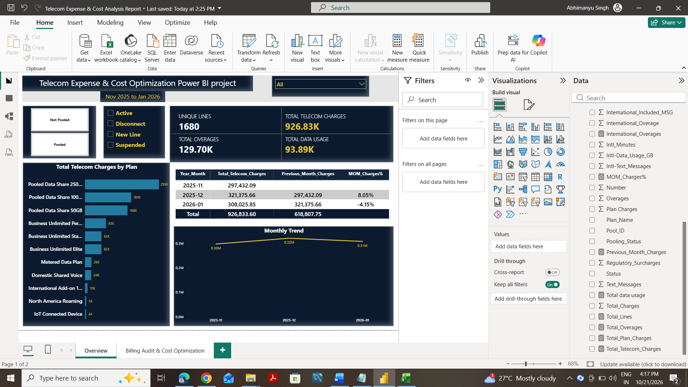
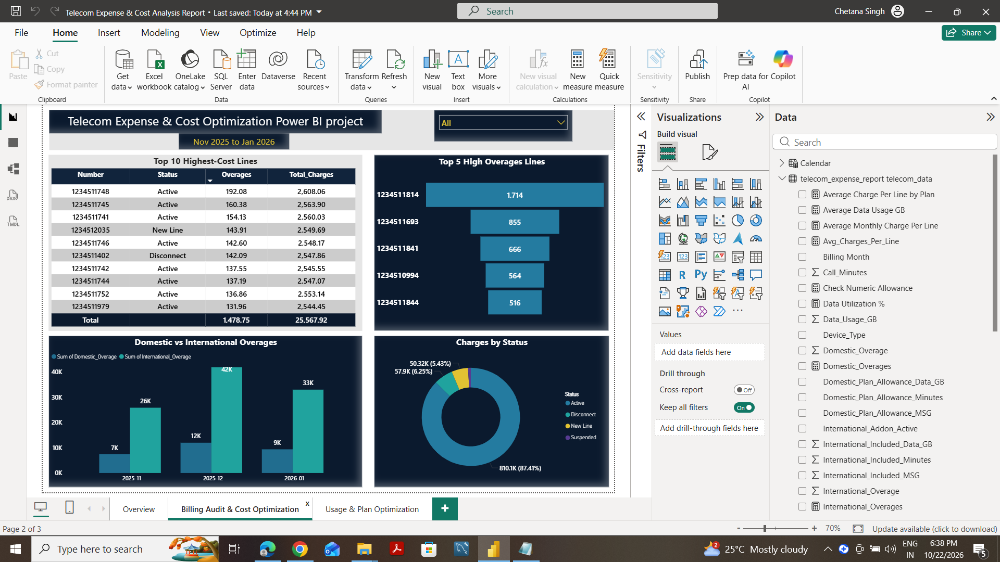
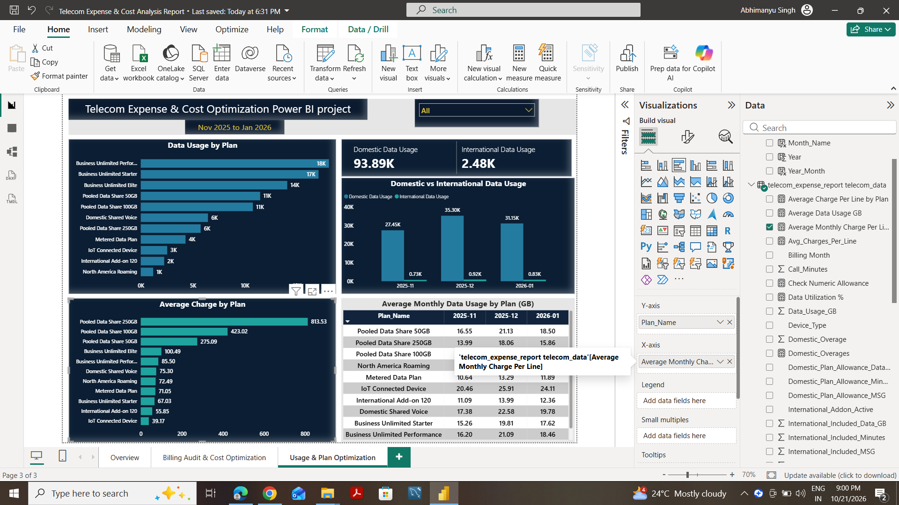

# Telecom Expense & Cost Optimization Analysis

### Power BI | MySQL | Excel | Data Analytics

## Project Overview

This project analyzes telecom billing, usage, and overage data to identify spending trends, investigate high-cost lines, evaluate plan usage, and uncover potential cost optimization opportunities.

The analysis combines telecom expense management concepts with SQL-based data analysis and interactive Power BI dashboards.

**Analysis Period:** November 2025 – January 2026

**Dataset:** 5,040 billing records covering 1,680 unique telecom lines across three months.

**Data Disclaimer:** This is a portfolio practice project using simulated telecom billing and usage data. The findings do not represent actual historical AT&T billing performance.

## Business Objectives

- Analyze overall telecom expenses and monthly spending trends.
- Identify high-cost telecom lines and overage charges.
- Compare domestic and international usage and overages.
- Evaluate telecom costs across different plans.
- Identify potential opportunities for expense reduction and plan optimization.

## Tools & Technologies

| Tool | Purpose |
|---|---|
| Microsoft Excel | Data preparation and validation |
| MySQL | Data exploration, aggregation, and analysis |
| Power BI | Data modeling, DAX calculations, and dashboard development |
| DAX | KPI calculations and month-over-month comparisons |

## Dashboard 1 — Telecom Expense Overview


Provides a high-level view of telecom spending.

**Key Metrics:**
- Total Telecom Charges: 926.83K
- Total Overages: 129.70K
- Unique Telecom Lines: 1,680
- Total Domestic Data Usage: 93.89K GB

**Visualizations:**
- Telecom Charges by Plan
- Monthly Telecom Expense Trend
- Month-over-Month Charge Analysis
- Billing and Line Status Filters

## Dashboard 2 — Billing Audit & Cost Optimization


Focuses on identifying high-cost lines and investigating overages.

**Visualizations:**
- Top 10 Highest-Cost Lines
- Top 5 Lines by Overages
- Domestic vs International Overages
- Total Charges by Line Status

**Business Purpose:** Help prioritize lines and billing patterns for further investigation.

## Dashboard 3 — Usage & Plan Optimization


Analyzes telecom data consumption and plan-level costs.

**Visualizations:**
- Domestic and International Data Usage KPIs
- Data Usage by Plan
- Monthly Domestic vs International Data Usage
- Average Monthly Charge Per Line by Plan
- Average Monthly Data Usage by Plan

**Business Purpose:** Understand usage patterns and identify plans that may benefit from additional review.

## Key Business Insights

### 1. Monthly Telecom Spending

Telecom charges increased from 297.43K in November 2025 to 321.38K in December 2025, representing approximately 8.05% growth.

Charges decreased to 308.03K in January 2026, approximately 4.15% below December.

### 2. Overage Charges

Total overages reached approximately 129.70K over the three-month period, representing about 14% of total telecom charges.

These charges represent an important area for cost investigation.

### 3. Domestic and International Overages

International overages were a substantial component of additional charges. International roaming activity, add-on coverage, and plan allowances are potential areas for further investigation.

### 4. High-Cost Telecom Plans

Pooled Data Share plans showed some of the highest average monthly charges per line.

These plans should be evaluated alongside their shared allowances, usage requirements, and billing structures before recommending changes.

### 5. Data Usage Trends

Domestic data usage was highest in December 2025, reaching approximately 35.30K GB.

This coincided with the highest monthly telecom charges and provides a useful starting point for investigating cost drivers.

## Cost Optimization Recommendations

1. Review recurring domestic and international overages to identify opportunities for better plan alignment.
2. Investigate high-cost lines and validate charges against applicable billing agreements.
3. Compare actual usage with available plan allowances before recommending upgrades or downgrades.
4. Review international add-on eligibility and roaming requirements.
5. Monitor telecom spending monthly using Power BI dashboards to detect unusual changes early.

**Note:** These are potential optimization opportunities. No realized financial savings are claimed.

## Project Structure

```text
Telecom-Expense-Cost-Optimization-Analysis/
│
├── Dataset/
│   └── Telecom_3_Month_Practice_Data.xlsx
│
├── SQL_Queries/
│   └── Telecom_Analysis.sql
│
├── PowerBI/
│   └── Telecom_Expense_Analysis.pbix
│
├── Dashboard_Screenshots/
│   ├── Dashboard_1_Overview.png
│   ├── Dashboard_2_Billing_Audit.png
│   └── Dashboard_3_Usage_Optimization.png
│
└── README.md
```

## Project Outcome

Developed three interactive Power BI dashboards covering telecom spending, billing audit, and usage optimization.

The project demonstrates the application of SQL, Power BI, DAX, and telecom domain knowledge to transform billing data into actionable business insights.

## Connect

**LinkedIn:** (https://www.linkedin.com/in/chetana-singh-520b1058)

**GitHub:** (https://github.com/Csingh2888/Telecom-Expense-Cost-Optimization-Analysis)
